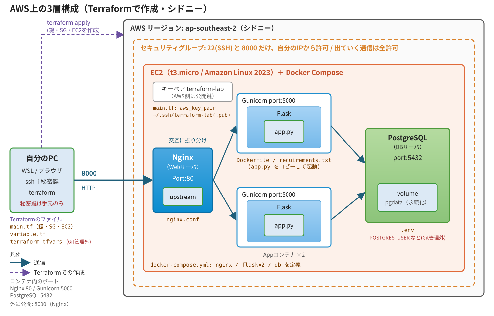

# WSL + Ubuntu + Nginx + Tomcat リバースプロキシ構築メモ

作業日: 2026-11-10

WSL2 上の Ubuntu に Nginx と Tomcat をインストールし、Nginx (80番) で受けたリクエストを Tomcat (8080番) へリバースプロキシで転送する手順。

## 構成

```
ブラウザ ──> Nginx :80 ──(proxy_pass)──> Tomcat :8080
```

## 環境

| 項目 | バージョン |
| --- | --- |
| OS | Ubuntu 26.04.1 LTS (WSL2) |
| Nginx | 1.28.3 |
| Tomcat | 10.1.55 (`tomcat10` パッケージ) |
| Java | OpenJDK 25 |

## 1. WSL に Ubuntu をインストール

Windows の PowerShell (管理者) で実行する。

```powershell
wsl --install -d Ubuntu
```

インストール後に再起動し、Ubuntu を起動してユーザー名とパスワードを設定する。

確認:

```powershell
wsl -l -v
```

`VERSION` が `2` になっていれば WSL2 で動いている。

## 2. パッケージを最新化

ここから先は Ubuntu のターミナルで実行する。

```bash
sudo apt update
sudo apt upgrade -y
```

## 3. Nginx をインストール

```bash
sudo apt install -y nginx
sudo systemctl enable --now nginx
```

確認:

```bash
nginx -v
systemctl status nginx
curl -I http://localhost
```

`HTTP/1.1 200 OK` が返り、ブラウザで `http://localhost` を開くと "Welcome to nginx!" が表示されれば OK。

## 4. Tomcat をインストール

Java (OpenJDK) は依存関係として一緒に入る。

```bash
sudo apt install -y tomcat10
sudo systemctl enable --now tomcat10
```

確認:

```bash
java -version
systemctl status tomcat10
curl -I http://localhost:8080
```

ブラウザで `http://localhost:8080` を開くと "It works !" が表示されれば OK。

## 5. Nginx からリバースプロキシで Tomcat へ転送

`/etc/nginx/sites-available/default` を編集する。

```bash
sudo nano /etc/nginx/sites-available/default
```

`location /` の中身を `proxy_pass` に書き換える。

```nginx
server {
	listen 80 default_server;
	listen [::]:80 default_server;

	root /var/www/html;
	index index.html index.htm index.nginx-debian.html;

	server_name _;

	location / {
		proxy_pass http://127.0.0.1:8080;
	}
}
```

構文チェックしてから反映する。

```bash
sudo nginx -t
sudo systemctl reload nginx
```

確認:

```bash
curl http://localhost
```

ポート番号なしの `http://localhost` で Tomcat の "It works !" ページが表示されればリバースプロキシ成功。

### Nginx 経由で Tomcat が応答しているかの見分け方

`curl -I http://localhost` の結果は `Server: nginx/1.28.3 (Ubuntu)` になる。これは Nginx が転送時に `Server` ヘッダーを自分の名前で上書きするためで、中身が Tomcat かどうかは別の項目で判断する。

```bash
curl -I http://localhost
curl -I http://127.0.0.1:8080
```

| 見るところ | Tomcat から返っている場合 |
| --- | --- |
| `ETag` | `W/"1905-1794309803442"` のような「サイズ-更新時刻(ミリ秒)」の形 (Nginx 自身なら `"xxxx-xxxx"` の16進数) |
| 80番と8080番の比較 | `ETag` と `Content-Length` が一致する |
| 本文 | `curl -s http://localhost \| grep -i "<title>"` で `<title>Apache Tomcat</title>` が出る |

## ハマった点

### セミコロンの付け忘れ

Nginx の設定は 1 つのディレクティブごとに末尾の `;` が必須。

```nginx
# NG
proxy_pass http://127.0.0.1:8080

# OK
proxy_pass http://127.0.0.1:8080;
```

付け忘れると `nginx -t` で次の行と繋がって解釈され、以下のようなエラーになる。

```
nginx: [emerg] invalid number of arguments in "proxy_pass" directive in /etc/nginx/sites-enabled/default:...
```

エラーで指摘される行が、実際に `;` を忘れた行の **次の行** になることがあるので、指摘行の 1 つ上も確認する。

`upstream` ブロックの `server` 行でも同じミスをした。

```nginx
# NG (2行が1つのディレクティブとして読まれる)
upstream tomcat {
	server 127.0.0.1:8080
	server 127.0.0.1:8081
}

# OK
upstream tomcat {
	server 127.0.0.1:8080;
	server 127.0.0.1:8081;
}
```


この場合は `;` がないまま `}` まで読み進むので、`unexpected "}"` のようなエラーになり、指摘されるのは `}` の行になる。

### upstream 名と proxy_pass の名前の不一致

`upstream` で付けた名前と `proxy_pass` に書く名前は完全に一致させる。

```nginx
upstream tomcat {
	...
}

# NG (s が余計)
proxy_pass http://tomcats;

# OK
proxy_pass http://tomcat;
```

不一致だと `nginx -t` で以下のエラーになる。

```
nginx: [emerg] host not found in upstream "tomcats" in /etc/nginx/sites-enabled/default:...
```

### 波カッコの閉じ忘れ

`server { ... }` や `location / { ... }` の `}` を閉じ忘れると、以下のエラーになる。

```
nginx: [emerg] unexpected end of file, expecting "}" in /etc/nginx/sites-enabled/default:...
```

ファイル末尾で怒られるので場所が分かりにくい。`{` と `}` の数が揃っているか、インデントを揃えて確認する。

### 教訓

- 設定を変えたら **必ず `sudo nginx -t` を実行してから** `reload` する
- `nginx -t` が `syntax is ok` / `test is successful` を返すまで反映しない

## よく使うコマンド

```bash
# 状態確認
systemctl status nginx
systemctl status tomcat10

# 再起動・設定反映
sudo systemctl restart nginx
sudo systemctl reload nginx
sudo systemctl restart tomcat10

# ログ
sudo tail -f /var/log/nginx/error.log
sudo journalctl -u tomcat10 -f
```

## 作業記録

### 2026-11-15 NginxからTomcaで負荷分散

#### 実行したコマンド

```bash
sudo nginx -t
sudo systemctl reload nginx
curl -I http://localhost/worklog
curl -I http://localhost/worklog/
sudo cp /etc/nginx/sites-available/default /etc/nginx/sites-available/default .bak
sudo cp /etc/nginx/sites-available/default /etc/nginx/sites-available/default.bak
sudo sed -i '/^\s*location \/ {/i\
\tlocation /worklog/ {\
\t\tallow 127.0.0.1;\
\t\tallow ::1;\
\t\tdeny all;\
\t\tproxy_pass http://127.0.0.1:8090/;\
\t\tproxy_set_header Host $host;\
\t}\
' /etc/nginx/sites-available/default
grep -n -B1 -A8 "location /worklog/" /etc/nginx/sites-available/default
curl -I http://localhost/worklog/
sudo nginx -t
curl -I http://localhost/worklog
sudo systemctl reload nginx.service
curl -I http://localhost/worklg
curl -I http://localhost/worklog
```

#### Nginx 設定

`/etc/nginx/sites-available/default`

```nginx
upstream tomcats {
	server 127.0.0.1:8080;
	server 127.0.0.1:8081;
}
server {
	listen 80 default_server;
	listen [::]:80 default_server;
	root /var/www/html;
	index index.html index.htm index.nginx-debian.html;
	server_name _;
	location /worklog/ {
		allow 127.0.0.1;
		allow ::1;
		deny all;
		proxy_pass http://127.0.0.1:8090/;
		proxy_set_header Host $host;
	}
	location / {
		proxy_pass http://tomcats;
	}
}
```

#### ハマった点

-upstream でserverのあとにコロンを忘れた

#### エラーログ

```
2026-11-15T18:39:37+09:00 DesktopPC tomcat10[292]: WARNING: A restricted method in java.lang.System has been called
2026-11-15T18:39:37+09:00 DesktopPC tomcat10[292]: WARNING: java.lang.System::load has been called by org.apache.tomcat.jni.Library in an unnamed module (file:/usr/share/java/tomcat10-jni-10.1.55.jar)
2026-11-15T18:39:37+09:00 DesktopPC tomcat10[292]: WARNING: Use --enable-native-access=ALL-UNNAMED to avoid a warning for callers in this module
2026-11-15T18:39:37+09:00 DesktopPC tomcat10[292]: WARNING: Restricted methods will be blocked in a future release unless native access is enabled
```

#### 環境

| 項目 | バージョン |
| --- | --- |
| OS | Ubuntu 26.04.1 LTS |
| nginx | 1.28.3-2ubuntu1.12 |
| openjdk-25-jdk-headless | 25.0.5.0.3+1-1~26.04.1 |
| openjdk-25-jre-headless | 25.0.5.0.3+1-1~26.04.1 |
| tomcat-jakartaee-migration | 1.0.10-2 |
| tomcat10 | 10.1.55-1ubuntu2~26.04.1 |
| tomcat10-common | 10.1.55-1ubuntu2~26.04.1 |

### 2026-11-15（続き） GitHub への push、アクセスログ集計、Flask + Docker

#### やったこと

1. このリポジトリを GitHub に push した
2. Nginx のアクセスログからステータスコードごとの件数を数えるスクリプトを書いた
3. Flask アプリを作り、gunicorn で動かして Nginx から転送した
4. 同じ Flask アプリを Docker イメージにして、コンテナで動かした

#### 1. GitHub に push

GitHub 側で空のリポジトリ `infra-notes` を作ってから実行する。

```bash
git branch -M main
git remote add origin https://github.com/<ユーザー名>/infra-notes.git
git push -u origin main
```

2 回目以降は `git push` だけでよい。

#### 2. アクセスログのステータスコード集計

`scripts/count_status.py`

```python
import sys
from collections import Counter

counts = Counter()
for line in open(sys.argv[1]):
    parts = line.split('"')
    if len(parts) < 3:
        continue
    status = parts[2].split()[0]
    counts[status] += 1

for status, n in sorted(counts.items()):
    print(status, n)
```

アクセスログは `www-data` 所有で読めないので、コピーして所有者を自分に変えてから使う。

```bash
cp /var/log/nginx/access.log ./access.log
sudo chown $USER access.log
python3 count_status.py access.log
```

```
200 77
```

ログの 1 行は `... "GET / HTTP/1.1" 200 911 ...` の形なので、`"` で区切った 3 つ目の先頭がステータスコードになる。

#### 3. Flask + gunicorn + Nginx

```bash
sudo apt install -y python3-venv
cd ~/infra-notes/flask-app
python3 -m venv .venv
source .venv/bin/activate
pip install flask gunicorn
```

`flask-app/app.py`

```python
from flask import Flask

app = Flask(__name__)

@app.route("/")
def index():
    return "Hellow from Flask\n"
```

開発用サーバーで確認したあと、gunicorn で動かす。

```bash
flask run --port 5000
gunicorn -w 2 -b 127.0.0.1:5000 app:app
curl http://localhost:5000
```

Nginx の `location /` の転送先を Tomcat から gunicorn に変えた。

```nginx
	location / {
		proxy_pass http://127.0.0.1:5000;
	}
```

```bash
sudo nginx -t
sudo service nginx reload
curl http://localhost
```

`.venv/` は `.gitignore` に入れてコミットしない。

#### 4. Docker でコンテナ化

`flask-app/requirements.txt`

```
flask
gunicorn
```

`flask-app/Dockerfile`

```dockerfile
FROM python:3.12-slim
WORKDIR /app
COPY requirements.txt .
RUN pip install -r requirements.txt
COPY app.py .
CMD ["gunicorn", "-w", "2", "-b", "0.0.0.0:5000", "app:app"]
```

コンテナの中では `0.0.0.0` で待ち受けないと、外（ホスト）から届かない。ホストの 5001 番をコンテナの 5000 番につなぐ。

```bash
sudo docker build -t flask-app .
sudo docker run -d -p 5001:5000 --name flask1 flask-app
curl http://localhost:5001
```

#### ハマった点

- `docker build -t flack-app` と打って、最後の `.`（ビルドに使うディレクトリ）を忘れた。`docker build` には場所の指定が必須
- イメージ名を `flack-app` とタイプミスしたまま、`docker run ... flask-app` で起動しようとした。ビルド時と起動時のイメージ名は完全に一致させる
- Nginx の転送先を 5000 番に変えたとき、`location /worklog/` の `proxy_pass` まで `5000` に変わってしまい、作業記録ツールの画面に Flask の応答が返るようになった。設定を置換で書き換えたら、`nginx -t` の前に変更箇所を `diff` で確認する

```bash
diff /etc/nginx/sites-available/default.bak /etc/nginx/sites-available/default
```

#### メモ

- コンテナを同じ名前で作り直すときは、先に古いコンテナを消す: `sudo docker rm -f flask1`
- upstream `tomcats` は残っているが、今はどこからも使っていない

## 用語のメモ(Web / アプリサーバの役割)

### Nginx(Webサーバ)
- 外からの通信を最初に受け取る(アプリサーバを直接晒さない＝安全性)
- `proxy_pass`でTomcatやGunicornに渡す(リバースプロキシ)
- `upstream`で複数台を並べると、ロードバランサにもなる(冗長性)
- 画像、CSS、HTML、は、アプリを通さずにNginxが返す(負荷軽減）


### 構成

```

Nginx → Tomcat → javaのアプリ
Nginx → Gunicorn → Flask(Pythonのアプリ)
```

### アプリとフレームワーク
- **Tomcat / Cosminexus**: Java用のアプリサーバ(Cosminexusは商用)
- **Gunicorn**: Python用のアプリサーバ。リクエストを受けて、Flaskのアプリを呼び出し、結果を返す。
- **Flask**: Pythonでウェブアプリを作るためのフレームワーク。URL毎に、動かす関数と返す内容を対応づける。
- **フレームワーク**:ウェブアプリに必要な共通の部品をあらかじめ用意してくれる枠組み
- TomcatとGunicornの違いは言語(Java / Python) と、機能の大きさ(Tomcatは多い、Gunicornは最小限)

## Docker Compose: Nginx + Flask + PostgreSQL(三層)

- `docker compose up -d ` でNginx / Flask(Gunicorn) / PostgreSQL を一コマンドで起動
- DBパスワードは`.env` に分けて、`.gitignore`　で除外(Githubには上げていない)
- DBのデータはvlume(`pgdata`)に保存。`docker compose down`　してもデータが残る(`-v` をつけると消える)
- コンテナ同士は、サービス名(`flask`,`db`)で通信する


### ハマった点

- `docker compose` が入っていなかった: `apt install docker-compose-v2`で解決
- Flaskが起動しなかった: `app.py` の`from`を`form`と打ち間違えていた。`docker compose logs flask`で原因を特定
- エラー500: SQLの`VALUES`　を　`VAULUES` と打ち間違えていた。ログで特定
- エラー502: Flaskが落ちていたのが原因。`docker compose -a` で`Exited` を確認  

## Docker Compose: Flask ２台　+ Nginx　負荷分散と停止試験

- `docker compose up -d --scale flask-2` でFlaskを２台起動し、Nginxの`upstream`　で振り分け
- `host:` (コンテナID)をレスポンスに出して、どちらが応答したか確認
- 一台を`docker stop` しても、もう一台からの応答が続くことを確認(停止試験)

### ハマった点

- ６回だけアクセスすると、片側にしか行かないように見えた。ログにエラーがなく、２台ともにつながった
- 原因は、Nginxのワーカー毎に振り分けの数え方が別だったこと。４０回アクセスすると両方に行くことで確認
- `upstream` に`zone flask_app 64k;`　を足して、ワーカ間で数え方を共有し、交互に振り分けた
- Compose内のコンテナ同士は、外側ポート(5001)でなく、中のポート(5000)でつなぐ

## Terraform(AWSにEC2を一台作成して削除)


### やったこと
- ap-

### 手順
- terraform init / fmt / validate / plan / apply / destroy の順

- `terraform init` 準備。`main.tf` に書いたプロバイダ(`hashicorp/aws`)　をダウンロードし、`.terraform/`　と `.terraform.lock.hcl` を作成。最初に一回と、プロバイダを変更するときに打つ。
- `terraform fmt` 書き方を整える。ファイルを直接書き換える。
- `terraform validate` 文法チェック。括弧の閉じ忘れや、存在しない項目名を見つける。AWSには接続しない。
- `terraform plan` 予行演習。「何が作られ、変わる、消える」を表示する。実際には作成しない。
- `terraform apply` 実行、planの内容を実際に作る。`yes`　を打つと確認が消える。
- `terraform destroy` 作ったものを全部消す。こちらも確認が出るので `yes`　で消える 。

### ハマった点

- plan で403(ec2:DescribeImages)
    - 原因      : 東京リージョン(ap-northeast-1)での操作が、組織側のポリシー(SCP)で拒否されたこと。自分のIAMユーザーの権限不足ではない。
    - 切り分け  : ec2:DescribeImagesが`explicit deny in a service control policy` ,`terraform-user` には`AmazonEC2FullAccess`をつけていた。IAMで許可しているのに拒否されているなら、IAMより上の制限(SCP)が原因だと判断した。
    - 対応      : 無料プランではシドニーリージョン(ap-southeast-2)しか使用できないため、`main.tf`　のproviderのregionをシドニーに変更。


### 学んだこと

- 無料プランは
- stateファイル(tfstate)と.terraform/をGitに入れない理由: 公開のリポジトリに環境の情報、秘密の情報が見えてしまうため。.terraform/はinitで再作成できるため。
- .terraform.lock.hcl をGitに入れる理由:使うプロバイダーの名前とバージョンを固定して誰がinitしても同じバージョンを使うため。
### やったこと

- ssh-keygenで鍵を作り、Terraformでキーペアとセキュリティグループを作成
- EC2を作成し、SSHで入ってDocker・Composeを導入
- flask-appを転送し、docker composeでNginx・Flask×2・PostgreSQLを起動
- 手元のPCから、EC2のパブリックIPの8000番にアクセスできることを確認

### 手順

- `ssh-keygen -t ed25519 -f ~/.ssh/terraform-lab` で鍵を作成（`-t` は鍵の種類、`-f` は保存先）
- `main.tf` に、公開鍵をAWSに登録するブロックを追加

```
resource "aws_key_pair" "lab" {
  key_name   = "terraform-lab"
  public_key = file(pathexpand("~/.ssh/terraform-lab.pub"))
}
```

- `main.tf` に、セキュリティグループを追加（SSHと8000番を、自分のIPだけに許可）

```
# IPを変数にして、terraform.tfvarsに分けた(gitに載せないため)
resource "aws_security_group" "ssh" {
  name        = "terraform-lab-ssh" # AWSコンソールに出てくるSGの名前
  description = "SSH form my IP only" # 説明文

  # 入ってくる通信のルール(SSH)
  ingress {
    description = "SSH"
    from_port   = 22
    to_port     = 22
    protocol    = "tcp"
    cidr_blocks = [var.my_ip]
  }

  # 入ってくる通信のルール(nginx 8000番)
  ingress {
    description = "Flask app via nginx" # コンソールから見える説明
    from_port   = 8000                  # ポートの番号の始まり
    to_port     = 8000                  # ポートの番号の終わり
    protocol    = "tcp"                 # 通信の種類
    cidr_blocks = [var.my_ip]           # 誰からの通信を許可するのか。自分のIPだけ /32
  }

  # 出ていく通信のルール
  # AWSコンソールで作るSGは、全部出ていけるルールがデフォルトで入るが、
  # Terraformで作る場合は入らないため、明示的に記載する
  egress {
    from_port   = 0              # protocolが全部なので慣例的な目的での記載
    to_port     = 0              # protocolが全部なので慣例的な目的での記載
    protocol    = "-1"           # すべてのプロトコル
    cidr_blocks = ["0.0.0.0/0"]  # どこに行ってもいい
  }
}
```

- `terraform.tfvars` に、SGで許可する自分のグローバルIPを設定（Gitに反映されないよう、別ファイルにした）
- `terraform apply` でEC2を作成
- `terraform state show aws_instance.lab | grep public_ip` でEC2のIPを取得
- `ssh -i ~/.ssh/terraform-lab ec2-user@<EC2IP>` でSSH接続（`-i` は秘密鍵の指定）
- EC2上で、Docker・Docker Compose・buildxを導入
- 手元から、`flask-app` を転送（下の「ハマった点」を参照）
- EC2上で `docker compose up -d --build` を実行して起動
- 手元から `curl http://<EC2IP>:8000` で、応答を確認

### ハマった点

- `scp` がタイムアウト：宛先に、自分のIPを指定していた。宛先は、EC2のパブリックIP
- 転送が遅い：`.venv` 配下のファイルが約1300個あり、時間がかかった。`Ctrl+C` で止めて、除外して再開した
  - `rsync -av --exclude '.venv' -e "ssh -i ~/.ssh/terraform-lab" /home/quick/infra-notes/flask-app ec2-user@<EC2IP>:~/`
- `Dockerfile` が見つからない：`rsync` は、送り元の末尾のスラッシュで、結果が変わる。スラッシュなしだと、`~/flask-app/` というフォルダができ、ありだと、中身が `~/` に、ばらばらに入る
- `docker compose up --build` が失敗：Composeのビルドに、新しいbuildxが必要だった。公式のバイナリを入れて、解決
- `curl` が返らない：Nginxの公開ポートは8000なのに、80番に送っていた

